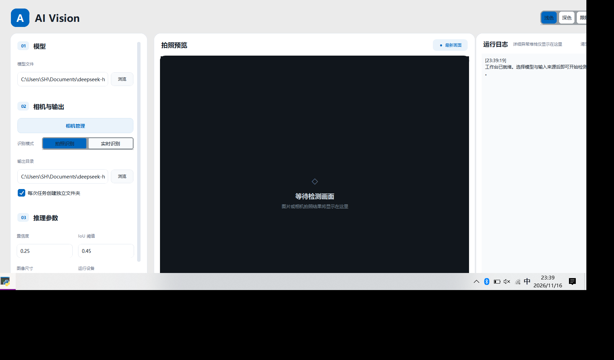

# AI Vision v2.6

[](LICENSE)
[](CHANGELOG.md)
[](#1-使用-exe)
[](#5-从源码运行)

> **开源说明**：本仓库是完整源码，含 `yolov8n.pt` / `yolov8n.onnx` 两个演示模型，clone 后按 §5 即可运行；
> 预编译便携版与安装版见 [Releases](https://github.com/shenghan1554/ai-vision/releases)。



**相机拍照/实时双模式检测｜PT / ONNX 可更换模型｜USB UVC｜海康 MVS**

在参考项目及早期版本基础上升级的 Windows 桌面程序，仅做相机采集与检测。v2.6：产品更名为 **AI Vision**；**删除“采集设置”面板**（原有参数已失效，采集参数全部自动化）；**修复相机多选 Bug**（此前多次点击会让多台相机同时显示“已选择”）；移除模型信息等说明性小字。v2.5 已实现相机持久连接与后台最新帧缓存，拍照延迟显著降低。

## 主要功能

- **YOLOv8 检测**：Ultralytics 统一加载 `.pt`、`.onnx`，无需改代码即可换模型。
- **现代桌面界面**：三栏布局（左侧设置、中间大预览、右侧运行日志），Win11 风格配色、浅色/深色/跟随系统。
- **USB 免驱相机**：DirectShow / Media Foundation 后端切换、实际取帧验证、曝光与增益。
- **海康工业相机**：动态接入官方 MVS SDK，支持 GigE Vision、USB3 Vision，按型号选择设备，支持曝光与增益。
- **输出更安全**：开始前真实测试目录可写性，每次任务独立 `run_*` 目录，图片/JSON 原子写入。
- **双识别模式**：拍照识别（拍一张即完成）与实时识别（持续预览，点停止结束并保存最后一帧）。
- **采集加速**：模型复用预热 + 相机持久连接 + 后台持续取帧缓存；拍照直接读最新帧。
- **实测速度**：USB 后续拍照约 0.12～0.16 秒，海康后续约 0.19～0.29 秒（本机环境，首次模型加载另计）。
- **结果形式**：时间戳标注图片 + 可选 JSON；不生成视频。

> 范围：YOLOv8 **detect** 目标检测。不支持分割、姿态、OBB、分类模型，也不处理视频文件。

## 1. 使用 EXE

解压 Windows 便携包，进入目录并双击：

```text
AIVision.exe
```

基本步骤：

1. 选择 YOLOv8 `.pt` 或 `.onnx` 模型。
2. 程序启动后会自动扫描并在“相机管理”中选择首个相机；也可手动刷新并选择型号。
3. 选择输出目录，建议保持“每次任务创建独立文件夹”开启。
4. 调整置信度、IoU、推理尺寸和计算设备。
5. 选择识别模式（拍照识别 / 实时识别）。拍照模式点一次即拍一张并完成识别；GUI 保持相机连接，实时模式点击“停止”保存最后一帧。

**必须保留 `_internal` 文件夹，不能只复制 EXE。** 整个目录可以移动，目标电脑不需要 Python、Docker 或 CUDA。海康功能需要目标电脑另行安装官方 MVS Runtime/SDK。

当前为 CPU 构建。PT + ONNX 双后端包含 PyTorch 等运行库，因此体积较大；源码中提供完整 PyInstaller 配置。

## 2. 更换模型

### PT

直接选择训练得到的 `best.pt` / `last.pt`，类别名从模型读取。

### ONNX

推荐使用 Ultralytics 从对应 PT 导出，以保留类别元数据：

```bash
yolo export model=best.pt format=onnx imgsz=640
```

类别名称直接使用模型内置信息，不再提供类别文件设置。

只加载自己训练或可信来源的 `.pt`，不要反序列化来历不明的 PyTorch 模型。

## 3. 相机采集

### USB 免驱相机

在相机管理中扫描并点击型号选择。Windows 下默认依次尝试 DirectShow、Media Foundation 和 OpenCV 默认后端。可设置宽度、高度、FPS、超时和 MJPG。

v2.1 不再向 UVC 驱动强行传入 `CAP_PROP_OPEN_TIMEOUT_MSEC`（属性 53），避免部分 MSMF 设备在 `openFinalize` 阶段失败。打开时支持短间隔重试；MJPG/自定义参数不被接受时，自动回退到驱动默认格式。设备详情显示实际后端、分辨率和是否使用兼容模式。

### 海康 MVS

相机管理中会列出设备型号（如 `MV-CU120-10GM`），点击即可选择；程序内部使用序列号定位设备，序列号变化或更换相机后重新刷新即可。

支持海康 MVS SDK 可访问的 GigE Vision / USB3 Vision 设备。请先在 MVS 客户端确认取图，并关闭客户端占用后再从本程序打开。

v2.1.1 在导入官方 Python 封装前，会注册架构匹配的 Runtime 目录，并通过绝对路径预加载 `MvCameraControl.dll`，不再依赖冻结程序中的普通 `PATH` 搜索。自定义安装位置可设置 `MVS_RUNTIME_PATH`；Python 封装位置可设置 `MVS_SDK_PYTHON_PATH`。

### 识别模式

| 模式 | 行为 |
| --- | --- |
| 拍照识别（默认） | 点一次“开始检测”：拍 1 张 → 识别 → 保存；GUI 中保持相机连接，便于下次立即拍照 |
| 实时识别 | 持续取流预览与识别；点“停止”结束并保存最后一帧，连接保留供下次使用 |

### 采集参数

采集设置面板已删除，所有采集参数（后端、超时、MJPG、分辨率、帧率）由程序自动选择，无需配置。相机管理列表只显示型号，点击型号即选择该相机，任何时刻只有一台处于“已选择”状态。

### 设备诊断

```bash
python detect.py --list-cameras
python tests/probe_usb.py --source 0 --backend auto --frames 30
```

## 4. 输出规则与权限修复

默认在选定目录下为每次任务创建：

```text
run_YYYYMMDD_HHMMSS_mmm/
```

| 来源 | 输出 |
| --- | --- |
| USB / 海康 · 拍照 | 生成一张时间戳 `.jpg`，可选同名 `.json` |
| USB / 海康 · 实时 | 停止时保存最后一帧 `.jpg`，可选同名 `.json` |

例如：`20261116_184447_791.jpg` 和 `20261116_184447_791.json`。

**不会生成 MP4、AVI 或其他视频文件。**

开始任务前会真实创建/删除测试文件，避免模型或相机启动后才发现目录不可写。若 Windows 桌面受“受控文件夹访问权限”保护，请改选程序目录下的 `output` 或其他可写目录。

图片和 JSON 使用临时文件 + 原子替换，失败时保留原文件并显示具体路径和系统错误。独立任务目录也避免同名旧文件被占用导致保存失败。

## 5. 从源码运行

推荐 64 位 Python 3.10～3.12：

```bash
python -m venv .venv
.venv\Scripts\python -m pip install -r requirements.txt
.venv\Scripts\python app.py
```

也可以配置环境后双击 `run_dev.bat`。

## 6. 命令行

USB 拍照检测（默认）：

```bash
python detect.py --source usb://0 --exposure 2000 --gain 2 --run-subdir --save-json
```

USB 实时识别（Ctrl+C 结束）：

```bash
python detect.py --source usb://0 --mode live --exposure 2000 --run-subdir --save-json
```

海康拍照检测（序列号由相机管理自动确定，`--mode live` 可切换实时）：

```bash
python detect.py --source hik://055062320032 --exposure 5000 --gain 1 --run-subdir --save-json
```

拍照模式下命令会自行结束并释放相机；实时模式按 Ctrl+C 结束。GUI 在切换相机、刷新扫描、异常或退出时释放连接。窗口版 EXE 也可通过 `AIVision.exe --cli ...` 调用同一核心，但日志显示请优先使用源码 `detect.py`。

输入仅支持相机；图片文件、目录和视频不再作为界面输入支持。

## 7. 构建 EXE

在联网的构建电脑双击：

```text
build_exe.bat
```

或：

```bash
python -m pip install -r requirements-build.txt
pyinstaller --noconfirm --clean AIVision.spec
```

输出：`dist/AIVision/AIVision.exe`。

打包规则包含 CustomTkinter 主题资源；海康专有 MVS SDK 从用户官方安装目录动态加载，不随 EXE 再分发。

## 8. 测试

```bash
python -m unittest discover -s tests -v
```

覆盖 PT/ONNX 实图、中文路径、目录、权限失败、独立输出目录、视频拒绝、USB 后端回退、曝光/增益、拍照/实时双模式、最新帧缓存、连接复用与释放、现代 GUI、海康模拟设备与资源释放。

构建后验证冻结 EXE：

```bash
python tests/validate_release.py
# 没有 USB 摄像头的构建机：
python tests/validate_release.py --skip-usb
# 可选：额外验证真实海康相机（替换为实际序列号）
python tests/validate_release.py --hik-serial DA8443879
```

冻结验证默认额外使用 DirectShow 和 Media Foundation 各执行一次真实 USB 拍照，可用 `--skip-usb` 跳过；可用 `--hik-serial` 附加真实海康验证。

## 9. 常见问题

- **输出目录不可写**：换到程序目录 `output`，检查受控文件夹访问权限、NTFS 权限和文件占用。
- **USB 能找到但打不开**：使用 v2.1 或更新版；旧版传入的可选超时属性可能被驱动拒绝。关闭占用软件后重试，分别尝试 DShow/MSMF，并保留自动默认格式回退。
- **USB 已打开但无画面**：关闭其他相机软件，检查隐私权限，分别尝试 DShow/MSMF，降低分辨率或取消 MJPG。
- **海康枚举为空**：先在 MVS 检查驱动、IP 同网段、防火墙和设备占用；未连接设备时为空属正常。
- **GPU 编号报错**：当前标准 EXE 为 CPU 版；GPU 需要对应 CUDA/PyTorch 环境重新构建。

## 10. 许可与第三方组件

**Copyright (C) 2026 AI Vision 项目。本项目以 [GNU Affero General Public License v3.0](LICENSE)（AGPL-3.0）发布。**

选择 AGPL-3.0 的原因：本项目使用 **Ultralytics YOLOv8**（AGPL-3.0 / 企业双许可）完成模型加载、
预处理、推理与标注，并随仓库分发 `yolov8n.pt` / `yolov8n.onnx` 两个 Ultralytics 预训练模型
（同属 AGPL-3.0 授权范围）。按上游许可，对外分发或作为网络服务提供本软件时，必须提供完整对应源码，
或向 Ultralytics 购买企业许可；不能闭源分发。

| 组件 | 许可 | 用途 |
| --- | --- | --- |
| Ultralytics | AGPL-3.0 / 企业双许可 | YOLOv8 模型加载、推理、NMS、标注 |
| 内置模型 `yolov8n.pt` / `yolov8n.onnx` | AGPL-3.0（随 Ultralytics 发布） | 演示模型 |
| PyTorch | BSD-3-Clause | PT 模型推理 |
| ONNX / ONNX Runtime | Apache-2.0 / MIT | ONNX 模型推理 |
| OpenCV | Apache-2.0 | 相机采集与图像处理 |
| CustomTkinter | MIT | 现代界面控件 |
| NumPy / Pillow / darkdetect | BSD-3-Clause / HPND / MIT | 基础依赖 |

**海康 MVS SDK**：程序仅在运行时从用户机器上已安装的官方 MVS 目录动态加载，
本仓库与发布包都**不包含**海康的专有 DLL/SDK。部署、升级与分发时请遵守海康的许可与现场授权要求。

完整清单见 [THIRD_PARTY_NOTICES.md](THIRD_PARTY_NOTICES.md)。该说明不构成法律意见。

## 11. 参与贡献

- 提 Issue 请附：Windows 版本、Python 版本、相机类型（USB / 海康型号）、报错日志与复现步骤。
- 提代码前请跑 `python -m unittest discover -s tests -v`，并确认没有把 `dist/`、`build/`、`.venv/`、
  `settings.json`、`output/` 下的产物混进提交。
- 内置模型是 Ultralytics COCO 演示权重；替换为自己训练的模型时，请同时确认训练数据与权重的授权。

---

**软件名称：** AI Vision
**版本：** 2.6.0
**技术栈：** Python / CustomTkinter / Ultralytics YOLOv8 / PyTorch / ONNX Runtime / OpenCV / 海康 MVS
